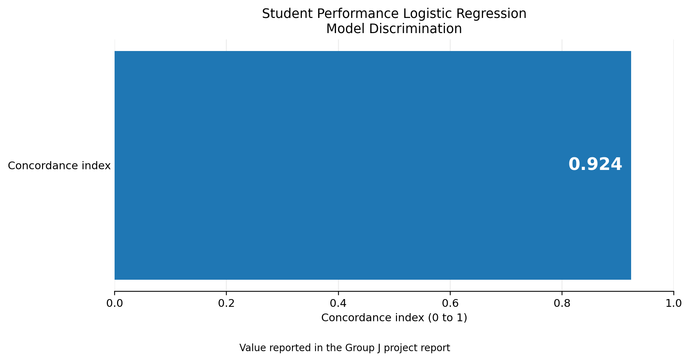

# Student Performance: Logistic Regression Analysis

## Project overview
A collaborative STAT305 project analysing student performance using education-related data. The aim was to investigate factors associated with students passing or failing.

## Research question
Which student and learning-related characteristics are associated with the outcome recorded as pass or fail?

## Data and variables
The report describes variables including gender, place of birth, education stage, family/guardian relationship, student absence days, grade, raised hands, visited learning resources, viewing announcements and discussion activity.

## Methods used
- Measurement-scale review and descriptive statistics
- One-way frequency tables
- Chi-square tests of association
- Logistic regression using SAS
- Predictor significance assessment
- Model selection using AIC
- Goodness-of-fit and overdispersion checks
- Odds-ratio interpretation and predicted probabilities

## Selected findings reported
- The report identified statistically significant associations between the result and several categorical variables, including gender, place of birth, stage, relation and student absence days.
- The final model described in the report included stage, relation, student absence days, grade, visited resources and announcements viewed.
- The report recorded a concordance index of 0.924 for its selected model.

## Tools
- SAS
- Logistic regression
- Descriptive and inferential statistics

## My contribution
This was a group university assignment. The report states that I worked on the report with a teammate. It is presented here as collaborative academic work, not as a solo project.

## Limitations and notes
The repository currently documents the analysis as described in the report. The original dataset and complete executable SAS project files have not yet been added. Results describe associations in the dataset and should not be interpreted as causal effects.

## Planned repository contents
- `README.md` — project overview and methods
- `code/` — reviewed SAS scripts, once checked and added
- `report/` — a public-safe, permission-cleared report or selected extracts, if appropriate
- `figures/` — charts recreated from the analysis, if available

## Model Performance

The logistic regression model achieved a reported concordance index of **0.924**.

This indicates strong discriminatory ability in distinguishing between students who passed and those who failed, based on the model's reported results.

## Tools and Methods

- **SAS:** Statistical analysis and logistic regression.
- **Chi-square tests:** Examining associations between categorical variables.
- **Logistic regression:** Modelling student pass/fail outcomes.
- **AIC:** Comparing candidate models.
- **Model diagnostics:** Assessing model performance.
